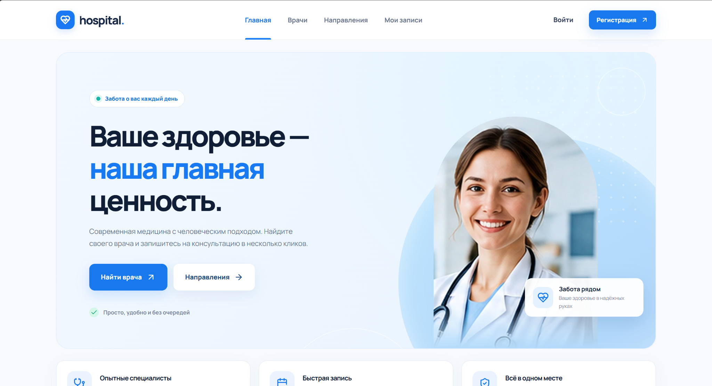
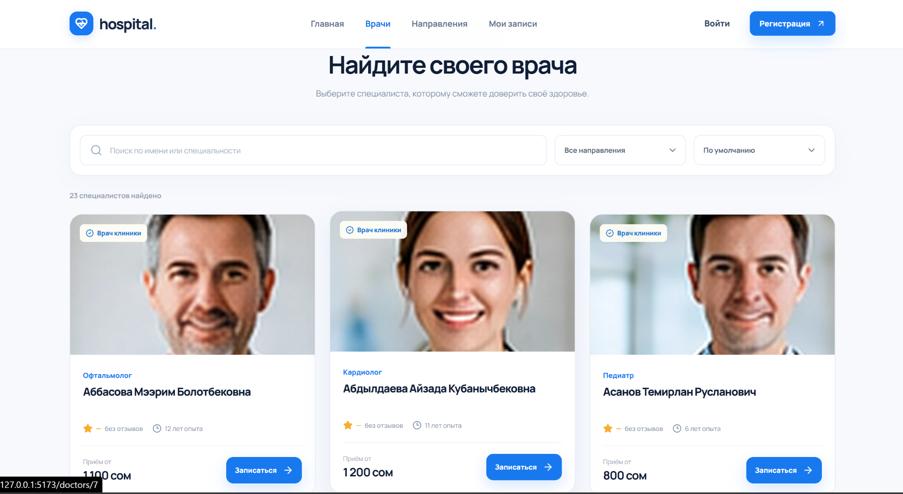
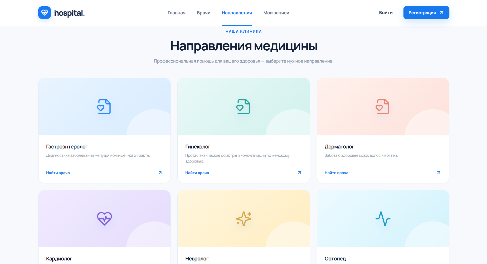

<div align="center">

# 🏥 Hospital

### Modern Clinic • Doctor Search • Online Appointments

**Учебное веб-приложение для клиники — Django REST API + React**

[](https://www.python.org/)
[](https://www.djangoproject.com/)
[](https://www.django-rest-framework.org/)
[](https://react.dev/)
[](https://vite.dev/)

[📸 Скриншоты](#-screenshots) • [✨ Возможности](#-features) • [🚀 Запуск](#-quick-start) • [🔌 API](#-api) • [📁 Структура](#-project-structure)

</div>

---

## 💙 About the Project

**Hospital** — учебный full-stack проект медицинской клиники. Пользователь может находить врачей, изучать специализации, смотреть расписание и записываться на консультации через современный интерфейс.

- **Backend:** Python, Django, Django REST Framework, SQLite, Token Authentication.
- **Frontend:** React 18, React Router, Vite, CSS, Lucide React.
- **Связь:** React запрашивает Django API по `/api/`; Vite проксирует запросы на локальный сервер `127.0.0.1:8000`.

> 🧪 **Демонстрационный проект.** Врачи, изображения и данные используются для учебных целей. Сервис не предназначен для хранения реальных медицинских данных.

## 📸 Screenshots

### 🏠 Главная страница

<div align="center"></div>

### 👩‍⚕️ Врачи и направления

<table>
<tr><th width="50%">Каталог врачей</th><th width="50%">Медицинские направления</th></tr>
<tr>
<td></td>
<td></td>
</tr>
</table>

## ✨ Features

| Для пациентов | Для управления клиникой |
| --- | --- |
| 🔎 Поиск и фильтрация врачей | 👨‍⚕️ Управление врачами и специализациями |
| 🗓️ Просмотр расписания | 📋 Управление расписанием и записями |
| 📝 Онлайн-запись и отмена приёма | 🏥 Медицинские записи с разграничением доступа |
| 🔐 Регистрация, вход, профиль | ⭐ Отзывы и рейтинги врачей |
| 📖 История записей | ⚙️ Django Admin и REST API |

## 🛠 Tech Stack

| Layer | Technologies |
| --- | --- |
| Backend | Python, Django, Django REST Framework |
| Frontend | React 18, React Router 6, Vite 5 |
| Styling | CSS, Lucide React icons |
| Database | SQLite (development) |
| Authentication | DRF Token Authentication |
| Version control | Git, GitHub |

## 📁 Project Structure

```text
Hospital/
├── Hospital_Backend/            # Django API
│   ├── clinic/                  # Models, serializers, views, permissions
│   ├── hospital_project/        # Django configuration
│   ├── manage.py
│   ├── requirements.txt
│   └── README.md                # Detailed backend API documentation
├── frontend/                    # React + Vite application
│   ├── public/
│   │   └── images/
│   ├── src/
│   │   ├── App.jsx
│   │   ├── api.js
│   │   ├── main.jsx
│   │   └── styles.css
│   ├── package.json
│   ├── package-lock.json
│   ├── vite.config.js
│   └── README.md
├── screenshots/
│   ├── home.png
│   ├── doctors.png
│   └── departments.png
├── .gitignore
└── README.md
```

## 🚀 Quick Start

Потребуются **Python 3.10+**, **Node.js 20+** и Windows PowerShell (или эквивалентный терминал).

### 1. Clone repository

```powershell
git clone https://github.com/Danieldev066/Hospital.git
cd Hospital
```

### 2. Start Backend (terminal 1)

```powershell
cd Hospital_Backend
py -m venv .venv
.\.venv\Scripts\python.exe -m pip install -r requirements.txt
.\.venv\Scripts\python.exe manage.py migrate
.\.venv\Scripts\python.exe manage.py seed_demo
.\.venv\Scripts\python.exe manage.py runserver
```

Откройте API: **http://127.0.0.1:8000/api/doctors/**. `seed_demo` нужен только для демонстрационных данных и может быть пропущен, если они уже существуют.

### 3. Start Frontend (terminal 2)

Из корневой папки `Hospital` (не из `Hospital_Backend`):

```powershell
cd frontend
npm ci
npm run dev
```

Откройте интерфейс: **http://127.0.0.1:5173/**.

**Важно:** оба сервера должны работать одновременно. Если сайт открывается, но врачи не показываются, сначала проверьте Django по `http://127.0.0.1:8000/api/doctors/`.

### Frontend build

```powershell
cd frontend
npm run build
```

## 🔌 API

Backend расположен по адресу `http://127.0.0.1:8000/api/`.

| Method | Endpoint | Description |
| --- | --- | --- |
| `POST` | `/api/register/` | Регистрация пользователя |
| `POST` | `/api/login/` | Авторизация; выдаёт токен |
| `POST` | `/api/logout/` | Выход |
| `GET / PATCH` | `/api/me/` | Профиль пользователя |
| `GET` | `/api/specializations/` | Медицинские специализации |
| `GET` | `/api/doctors/` | Каталог врачей; поиск и фильтрация |
| `GET` | `/api/schedules/` | Расписание |
| `GET / POST` | `/api/appointments/` | Записи на приём |
| `GET` | `/api/medical-records/` | Медицинская история с проверкой прав |
| `GET / POST` | `/api/reviews/` | Отзывы о врачах |

Для защищённых запросов используется заголовок `Authorization: Token <your-token>`.

📚 [Полное описание API и правил доступа](Hospital_Backend/README.md).

## 🔒 Security & Development Notes

- `.env`, `.venv`, `node_modules`, базы SQLite и конфигурации IDE не должны попадать в GitHub.
- `frontend/vite.config.js` проксирует `/api/` и `/media/` на Django **только в режиме разработки**. Для публичного развёртывания потребуются отдельная настройка сервера, HTTPS и безопасные переменные окружения.
- В проекте демонстрационные данные; **не вводите реальные диагнозы и персональные данные пациентов**.

## 👨‍💻 Author

**Danieldev066** — Python Backend Developer / Student  
🔗 [GitHub Profile](https://github.com/Danieldev066)

---

<div align="center"><sub>Made for learning · Hospital Project</sub></div>
